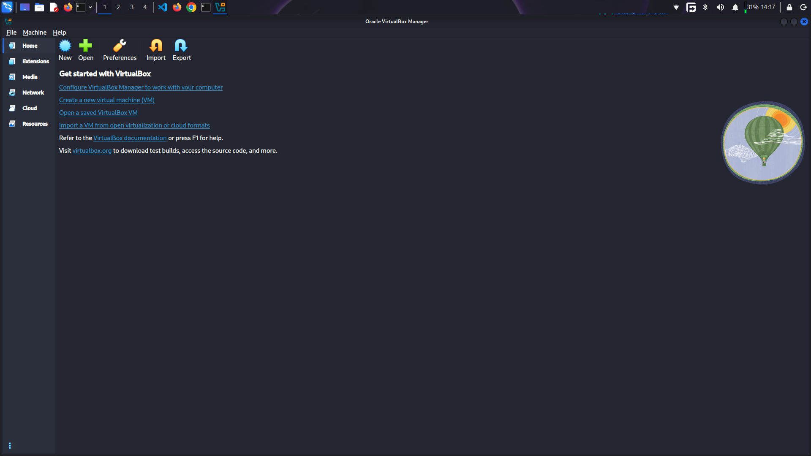
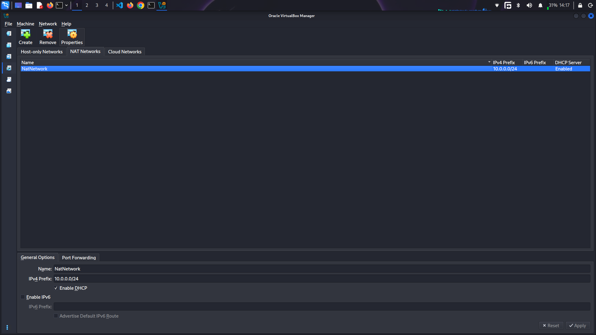
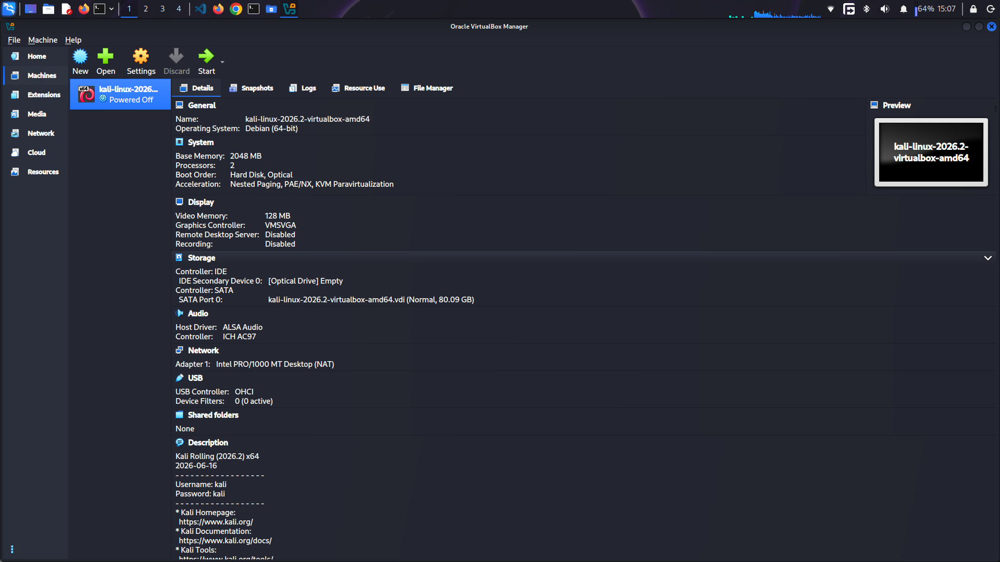
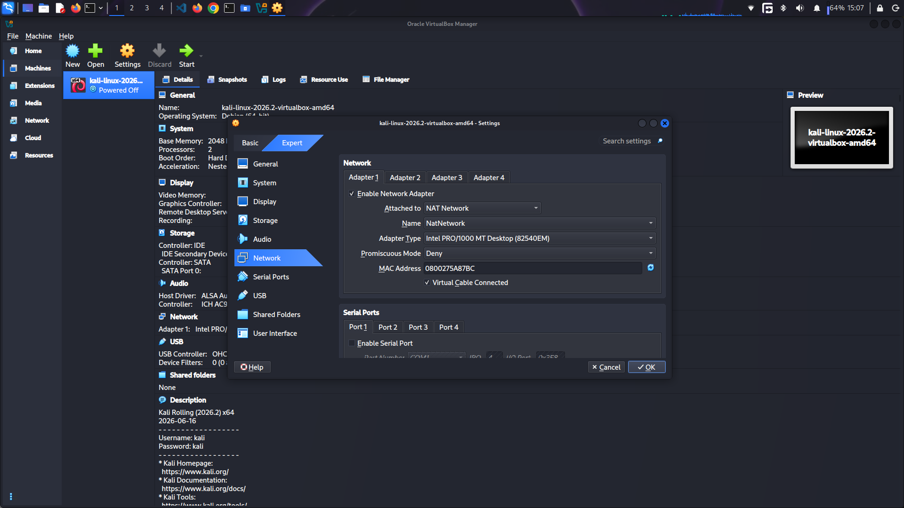
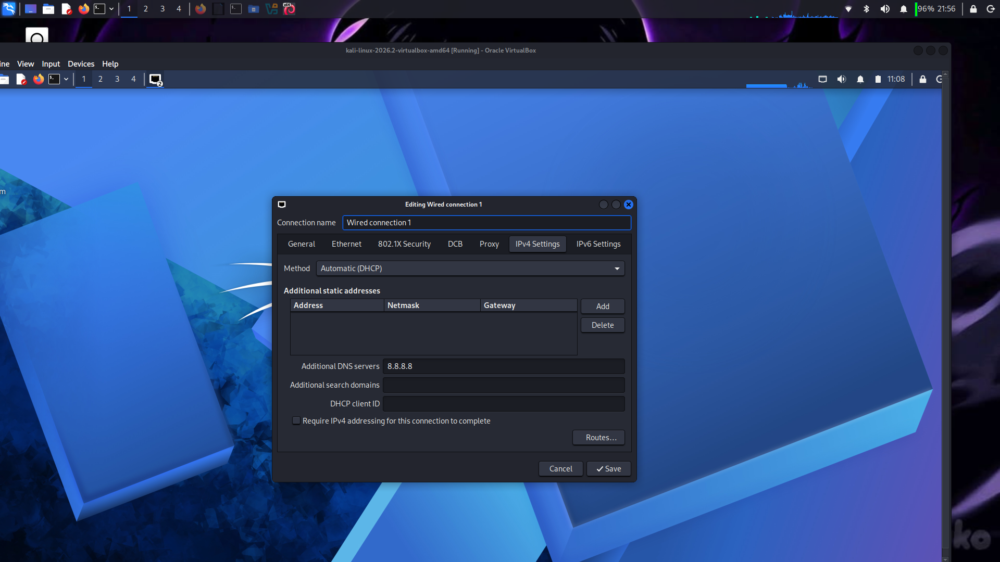

# NETWORKWALKS-EMMANUEL-B084-WK1-PM1-CYBERSECURITY-LAB_SETUP
# Kali Linux VirtualBox Setup Guide

A step-by-step guide to installing, configuring, and setting up a Kali Linux Virtual Machine (VM) in Oracle VirtualBox with a custom NAT Network and DNS configuration.

---

## 🛠️ Prerequisites & Requirements

Before beginning the installation, download and install the following components:

1. **File Extractor:** [7-Zip](https://www.7-zip.org/) or WinRAR
2. **Hypervisor:** [Oracle VirtualBox](https://www.virtualbox.org/)
3. **VM Image:** [Kali Linux Virtual Machine Image](https://www.kali.org/)

---

## 🚀 Step-by-Step Installation Guide

### Step 1: Download Required Software
Download all three required software packages listed in the requirements section.

---

### Step 2: Extract Kali Linux
Install **7-Zip** (or WinRAR) and extract the downloaded Kali Linux pre-built virtual machine archive (`.7z` or `.zip`) to a location on your local drive.

---

### Step 3: Install VirtualBox
Run the standard installer for **VirtualBox** and complete the default setup wizard.

---

### Step 4: Open Network Tools
In the VirtualBox Manager interface, navigate to **File** → **Tools** → **Network**.

---

### Step 5: Select NAT Networks
Click on the **NAT Networks** tab from the top menu.

---

### Step 6: Create NAT Network
1. Click **Create** at the top toolbar.
2. Select the newly created network (`NatNetwork`).
3. Enter or verify the preferred IP block (e.g., `10.0.0.0/24`) in the **IPv4 Prefix** field.
4. Click **Apply**.

---

### Step 7: Open Existing Virtual Machine
Click **Machine** from the top menu bar and select **Add** (or **Open**).

---

### Step 8: Locate Extracted Files
Browse to the folder directory where you extracted the Kali Linux files in **Step 2**.

---

### Step 9: Import the VM
Select the Kali Linux `.vbox` configuration file to add the machine to VirtualBox Manager.

---

### Step 10: Select Kali Machine
Click on the newly imported **Kali Linux** virtual machine from the left sidebar list.

---

### Step 11: Open Settings
Click on the **Settings** gear icon in the top toolbar.

---

### Step 12: Configure Network Adapter
1. Navigate to **Network** → **Adapter 1**.
2. Change the **Attached to** option to **NAT Network**.
3. Select **NatNetwork** under the **Name** drop-down menu.
4. Click **OK** to save settings.

---

### Step 13: Boot the Virtual Machine
Click **Start** to boot up your Kali Linux machine.

> 🔑 **Default Credentials:**
> * **Username:** `kali`
> * **Password:** `kali`

---

### Step 14: Edit Network Connections
Once inside the Kali Linux Desktop:
1. Right-click the **Ethernet Network Connection** icon on the top panel.
2. Select **Edit Connections...**

---

### Step 15: Open Connection Properties
Double-click on the active network profile (e.g., **Wired connection 1**).

---

### Step 16: Configure DNS Server
1. Go to the **IPv4 Settings** tab.
2. Add your preferred DNS IP address (e.g., `8.8.8.8`) into the **Additional DNS servers** field.
3. Click **Save**.

---

## 📌 Summary of Default Settings

| Item | Default / Recommended Value |
| :--- | :--- |
| **VM Credentials** | `kali` / `kali` |
| **Network Type** | NAT Network (`NatNetwork`) |
| **Subnet Prefix** | `10.0.0.0/24` |
| **Additional DNS** | `8.8.8.8` |
